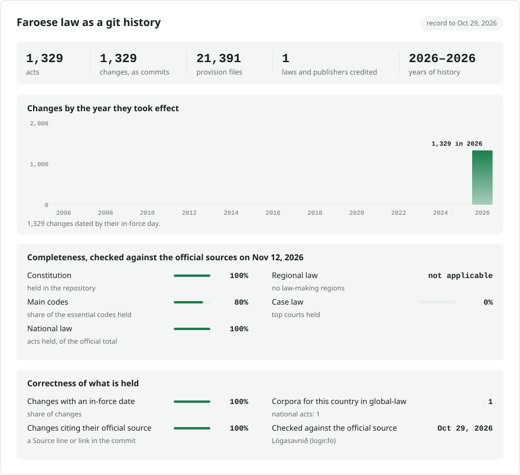

# Faroe Islands: law history in git

**English** · **[Ella les tað á føroyskum](README.md)**

<picture>
<source media="(prefers-color-scheme: dark)" srcset="data/effort-dark.svg">

</picture>

The law of the Faroe Islands in git: one file per §, and each act's current text as Lógasavnið, the official law collection, publishes it. Lógasavnið keeps no earlier consolidations, so each act's record starts at the text read on 29 October 2026: `git log` lists every change to a § from that day, the act's notes name the acts that amended it, and its date record gives the day the current text took effect, where the source establishes it.

Part of [lexifina/global-law](https://github.com/lexifina/global-law), one git history for every country's law: this is the national law of the Faroe Islands, which global-law reads at `faroe-islands/national/acts/`.

**What is in it now:** the 1,329 acts Lógasavnið listed as in force on 29 October 2026, each with its current text: 444 løgtingslógir (acts of the Løgting), 882 kunngerðir (executive orders) and 3 løgtingslógarkunngerðir (consolidated acts); for 659 of them, the day that text took effect. [`laws.csv`](laws.csv) lists every act with its dates, authority and folder; [`SOURCES.md`](SOURCES.md) says what each source gives.

Each act is in `<kind>/<year>/<number>/`, one file per § (`logtingslog/2000/70/paragraf-1.md` is § 1 of the Løgtingslóg um arbeiðsumhvørvi, the Working Environment Act, Løgtingslóg nr. 70 frá 11. mai 2000), with annexes as `fylgiskjal-<n>.md` and the reading order in `index.txt`. The Løgtingslóg um stýrisskipan Føroya, the Act on the Faroese system of government, is [`logtingslog/1994/103/`](logtingslog/1994/103/).

The text is in Faroese (13 acts in Danish, 28 in both), as Lógasavnið prints it. An English translation is not part of this record.

## Questions as git commands

| Question | Command |
| --- | --- |
| Every change to § 1 of the Working Environment Act (the first commit is its text as read) | `git log -p --word-diff -- logtingslog/2000/70/paragraf-1.md` |
| Which acts amended each § of it, as Lógasavnið's notes name them? | `git grep "^logtingslog/2000/70," -- data/amendments.csv` |
| The day its current text took effect, and the clause that gives it | `git show main:logtingslog/2000/70/date-basis.json` |
| § 1 as this record holds it on a date (from 29 October 2026) | `python tools/in_force_on.py 2026-11-01 logtingslog/2000/70 paragraf-1` |

**Outside git**, we also host this record publicly, for free:

- **[Ask Claude about Faroese law](https://global-law.lexifina.com/v1/try_claude?country=faroe-islands)**: opens Claude with a first question ready.
- **[Ask ChatGPT](https://global-law.lexifina.com/v1/try_chatgpt?country=faroe-islands)**: the same question in ChatGPT.
- **[Search Faroese law on our site](https://lexifina.com/law?country=faroe-islands&q=fr%C3%ADt%C3%AD%C3%B0)**: a search for "frítíð" (paid holiday), with each provision's text and its versions, no account needed.
- **[Developer REST API](https://global-law.lexifina.com/v1/search_law?query=fr%C3%ADt%C3%AD%C3%B0&jurisdiction=faroe-islands)**: the same search as JSON, with no key. See the [documentation here](https://lexifina.com/api/global-law).

Both assistants read the record through the free Global law connector (MCP, `https://global-law.lexifina.com/mcp`); the first time, the chat gives you the link that adds it. Ask in Faroese or in English.

**Host it yourself easily.** All it takes is git and Python, and the tools run on your machine:

```sh
git clone --depth 1 https://github.com/lexifina/global-law && cd global-law
python3 tools/countries.py add faroe-islands/national/acts
python3 tools/law.py show 2026-11-01 faroe-islands/national/acts/logtingslog/2000/70/paragraf-1.md
```

Opened in Claude Code, Cursor, VS Code or Codex, the clone also starts a local MCP server with the same tools ([MCP.md](https://github.com/lexifina/global-law/blob/main/MCP.md)).

## Dates

Each act's text is one commit dated at noon, Faroe time, on 29 October 2026, the day it was read: Lógasavnið gives no date for its consolidations. That commit's `In-force:` trailer is the reading day, not the day the text took effect; the correction commits of 4 November 2026 (`Kind: correction`) withdraw it and record, in [`data/source-dates.json`](data/source-dates.json) and the act's `date-basis.json`:

- for 659 acts, the day the current text took effect, from the act's own commencement clause or that of the latest amendment the source names (`In-force:`, the clause quoted in `In-force-basis:`);
- for 262 acts, only `Text-as-of: 2026-10-29`: when the whole current text took effect is not established, so no day is given;
- for 408 acts, held (commencement split, delegated or retroactive, no commencement clause, or images still to check): the reason, and no day.

Every text is credited to its publisher, Lógasavnið (Løgmansskrivstovan): without the earlier wording no line can be credited to the act that wrote it, so `git blame` names Lógasavnið. The acts that amended a provision are named in each act's `notes.md` and in [`data/amendments.csv`](data/amendments.csv) (9,801 rows naming 1,409 amending acts).

## How it is checked

- `tools/build/check_repo.py` reads every act back from git in `index.txt` order and compares its letters and digits with the page Lógasavnið served, independently of the builder: 12,890,604 letters and digits of 1,329 acts at the build, no mismatch. The sha256 of every page read is in [`data/source-sha256.tsv`](data/source-sha256.tsv).
- It also checks that every commit's trailers parse, that there are no merge commits and no dates after the build day, and that `tools/in_force_on.py` prints the right text and refuses a date before the record.
- A date is appended only after a review of its source evidence; the corrections change no law text ([`REPRODUCE.md`](REPRODUCE.md)).
- History is append-only: corrections are new commits that name the commit they correct (`Corrects:`), and no published commit is rewritten.

## What it does not show

- **Earlier wording.** Lógasavnið keeps no earlier consolidations, and the acts as first published in Kunngerðablaðið were not read: nothing before 29 October 2026 is here.
- **When some texts took effect.** 262 acts give only the day they were read and 408 are held; `data/source-dates.json` gives each reason.
- **Images** (forms, tables, formulas drawn as pictures) are `[image]` in the files: 31 acts have 107 of them, and those acts are held.
- **Other rules on Lógasavnið**: acts no longer or not yet in force, amending acts (listed apart), and Danish laws and orders in force for the Faroe Islands.
- **Case law, treaties and bills.** None is here.

## Sources

| Source | Kind | Past versions | Notes |
| --- | --- | --- | --- |
| [Lógasavnið](https://logir.fo) (Løgmansskrivstovan) | Official law collection: løgtingslógir, kunngerðir and løgtingslógarkunngerðir | no, the current text only | Each act's text, its notes naming the amending acts, and its dates; the text published in Kunngerðablaðið is binding |

## Licence

See [`LICENSE`](LICENSE). Official texts are not protected by copyright in the Faroe Islands (Løgtingslóg nr. 30 frá 30. apríl 2015 um upphavsrætt, § 9, stk. 1, here as `logtingslog/2015/30/paragraf-9.md`); their wording was not changed. Lexifina's tools, file arrangement, commit messages and documentation are CC0 1.0.

The tools and metadata were prepared with AI assistance; no AI model changed the text of an act.

## More

From [lexifina/global-law](https://github.com/lexifina/global-law):

- [FEATURES.md](https://github.com/lexifina/global-law/blob/main/FEATURES.md): every feature, and what every corpus must support (`git blame`, `law.py`, the MCP tools)
- [FAQ.md](https://github.com/lexifina/global-law/blob/main/FAQ.md): questions and answers · [CONTRIBUTING.md](https://github.com/lexifina/global-law/blob/main/CONTRIBUTING.md): proposing changes · [MCP.md](https://github.com/lexifina/global-law/blob/main/MCP.md): the MCP server · [REPRODUCE.md](https://github.com/lexifina/global-law/blob/main/REPRODUCE.md): how it was built · [CHANGELOG.md](https://github.com/lexifina/global-law/blob/main/CHANGELOG.md)
- [FRESHNESS.md](https://github.com/lexifina/global-law/blob/main/FRESHNESS.md): how current each corpus is · [Monitoring](https://github.com/lexifina/global-law/tree/main/monitoring): whether updates are running · [WATCHING.md](https://github.com/lexifina/global-law/blob/main/WATCHING.md): how each official source is watched for changes
- [performance/](https://github.com/lexifina/global-law/tree/main/performance): how fast the tools are, measured
- [visualisations/](https://github.com/lexifina/global-law/tree/main/visualisations): charts and bridges across the world's law
- [Vulnerabilities](https://github.com/lexifina/global-law/tree/main/vulnerabilities): mistakes in legislation as published
