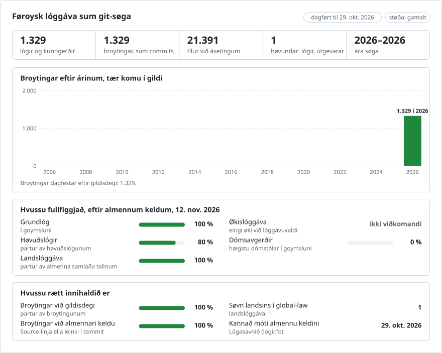

# Føroyar: lógarsøga í git

**Føroyskt** · **[Or read it in English](README.en.md)**

<picture>
<source media="(prefers-color-scheme: dark)" srcset="data/fo/effort-dark.svg">

</picture>

Lóggáva Føroya í git: ein fíla fyri hvønn §, og núgaldandi teksturin í hvørjum skjali, soleiðis sum Lógasavnið, almenna lógarsavnið, gevur hann út. Lógasavnið goymir ikki eldri útgávur av tekstunum, so søgan hjá hvørjum skjali byrjar við tekstinum, sum varð lisin 29. oktober 2026: `git log` vísir hvørja broyting í einum § frá tí degi, viðmerkingarnar til skjalið nevna tey skjøl, sum hava broytt tað, og dagfestingarskrásetingin vísir, nær núgaldandi teksturin kom í gildi, har sum keldan staðfestir tað.

Partur av [lexifina/global-law](https://github.com/lexifina/global-law), eini git-søgu fyri lóggávuna í øllum londum: hetta er landslóggáva Føroya, sum global-law lesur í `faroe-islands/national/acts/`.

**Hvat savnið inniheldur nú:** tey 1.329 skjølini, sum Lógasavnið vísti sum galdandi 29. oktober 2026, hvørt við sínum núgaldandi teksti: 444 løgtingslógir, 882 kunngerðir og 3 løgtingslógarkunngerðir; fyri 659 av teimum eisini dagin, tá ið teksturin kom í gildi. [`laws.csv`](laws.csv) vísir øll skjølini við dagfestingum, myndugleika og mappu; [`SOURCES.md`](SOURCES.md) sigur, hvat hvør kelda gevur.

Hvørt skjal er í `<slag>/<ár>/<nummar>/`, ein fíla fyri hvønn § (`logtingslog/2000/70/paragraf-1.md` er § 1 í løgtingslóg um arbeiðsumhvørvi, Løgtingslóg nr. 70 frá 11. mai 2000), við fylgiskjølum sum `fylgiskjal-<n>.md` og lesiraðfylgjuni í `index.txt`. Løgtingslóg um stýrisskipan Føroya er [`logtingslog/1994/103/`](logtingslog/1994/103/).

Teksturin er á føroyskum (13 skjøl á donskum, 28 á báðum), sum Lógasavnið prentar hann. Ein ensk umseting er ikki partur av hesum savni.

## Spurningar sum git-boð

| Spurningur | Boð |
| --- | --- |
| Hvør broyting í § 1 í arbeiðsumhvørvislógini (fyrsta goymingin er teksturin, sum varð lisin) | `git log -p --word-diff -- logtingslog/2000/70/paragraf-1.md` |
| Hvørji skjøl broyttu hvønn § í henni, sum viðmerkingarnar í Lógasavninum nevna tey? | `git grep "^logtingslog/2000/70," -- data/amendments.csv` |
| Dagurin, tá ið núgaldandi teksturin kom í gildi, og ásetingin, sum gevur hann | `git show main:logtingslog/2000/70/date-basis.json` |
| § 1, sum savnið hevur hann ein ávísan dag (frá 29. oktober 2026) | `python tools/in_force_on.py 2026-11-01 logtingslog/2000/70 paragraf-1` |

**Uttan fyri git** gera vit eisini hetta savnið alment og ókeypis tøkt:

- **[Spyr Claude um føroyska lóggávu](https://global-law.lexifina.com/v1/try_claude?country=faroe-islands)**: letur Claude upp við einum fyrsta spurningi til reiðar.
- **[Spyr ChatGPT](https://global-law.lexifina.com/v1/try_chatgpt?country=faroe-islands)**: sami spurningur í ChatGPT.
- **[Leita í føroyskari lóggávu á heimasíðu okkara](https://lexifina.com/law?country=faroe-islands&q=fr%C3%ADt%C3%AD%C3%B0)**: leiting eftir „frítíð“, við tekstinum í hvørji áseting og útgávum hennara, uttan konto.
- **[REST API fyri forritarar](https://global-law.lexifina.com/v1/search_law?query=fr%C3%ADt%C3%AD%C3%B0&jurisdiction=faroe-islands)**: sama leiting sum JSON, uttan lykil. Skjalfestingin er [her](https://lexifina.com/api/global-law).

Báðir hjálpararnir lesa savnið gjøgnum ókeypis Global law-sambindingina (MCP, `https://global-law.lexifina.com/mcp`); fyrstu ferð gevur kjakið tær leinkið, sum leggur hana afturat. Spyr á føroyskum ella á enskum.

**Lætt at hýsa sjálvur.** Alt, sum krevst, er git og Python, og amboðini koyra á tíni egnu teldu:

```sh
git clone --depth 1 https://github.com/lexifina/global-law && cd global-law
python3 tools/countries.py add faroe-islands/national/acts
python3 tools/law.py show 2026-11-01 faroe-islands/national/acts/logtingslog/2000/70/paragraf-1.md
```

Latið upp í Claude Code, Cursor, VS Code ella Codex byrjar avritið eisini ein staðbundnan MCP-ambætara við somu amboðum ([MCP.md](https://github.com/lexifina/global-law/blob/main/MCP.md)).

## Dagfestingar

Teksturin í hvørjum skjali er ein goyming, dagfest kl. 12 á føroyskari tíð 29. oktober 2026, tann dagin hann varð lisin: Lógasavnið gevur ongan dag fyri sínar útgávur. Linjan `In-force:` í teirri goymingini er lesidagurin, ikki dagurin, tá ið teksturin kom í gildi; rættingargoymingarnar frá 4. november 2026 (`Kind: correction`) taka hana aftur og skráseta í [`data/source-dates.json`](data/source-dates.json) og í `date-basis.json` hjá skjalinum:

- fyri 659 skjøl dagin, tá ið núgaldandi teksturin kom í gildi, eftir gildiskomuásetingini í skjalinum sjálvum ella í seinastu broytingini, sum keldan nevnir (`In-force:`, við ásetingini endurgivnari í `In-force-basis:`);
- fyri 262 skjøl bert `Text-as-of: 2026-10-29`: tað er ikki staðfest, nær allur núgaldandi teksturin kom í gildi, so eingin dagur er givin;
- fyri 408 skjøl, sum eru hildin aftur (gildiskoman er býtt sundur, løgd til annan myndugleika ella afturvirkandi, eingin gildiskomuáseting er, ella myndir skulu enn kannast): orsøkina og ongan dag.

Hvør tekstur er tilskrivaður útgevaranum, Lógasavninum (Løgmansskrivstovan): uttan eldri orðingina kann eingin linja tilskrivast tí skjalinum, sum skrivaði hana, so `git blame` nevnir Lógasavnið. Skjølini, sum hava broytt eina áseting, eru nevnd í `notes.md` hjá hvørjum skjali og í [`data/amendments.csv`](data/amendments.csv) (9.801 rekkjur, sum nevna 1.409 broytingarskjøl).

## Hvussu tað verður kannað

- `tools/build/check_repo.py` lesur hvørt skjal aftur úr git í raðfylgjuni í `index.txt` og samanber bókstavir og tøl við síðuna, sum Lógasavnið veitti, óheft av byggiforritinum: 12.890.604 bókstavir og tøl í 1.329 skjølum við byggingina, eingin munur. sha256 fyri hvørja síðu, sum varð lisin, er í [`data/source-sha256.tsv`](data/source-sha256.tsv).
- Tað kannar eisini, at linjurnar aftast í hvørjum goymingarboði kunnu lesast, at eingin merge-goyming er og eingin dagur eftir byggidagin, og at `tools/in_force_on.py` prentar rætta tekstin og noktar einum degi undan savninum.
- Ein dagfesting verður bert løgd afturat, eftir at prógvið í keldunum er eftirkannað; rættingarnar broyta ongan lógartekst ([`REPRODUCE.md`](REPRODUCE.md)).
- Søgan verður bert løgd afturat: rættingar eru nýggjar goymingar, sum nevna ta goyming, tær rætta (`Corrects:`), og eingin útgivin goyming verður skrivað um.
- [vulnerabilities/](vulnerabilities/): møguligar orðingarfeilir í hesum rætti, funnir av kanningaramboðunum hjá global-law og eftirkannaðir við hond. Ikki koyrt enn.

## Hvat savnið ikki vísir

- **Eldri orðingar.** Lógasavnið goymir ikki eldri útgávur, og skjølini, sum tey fyrst vórðu kunngjørd í Kunngerðablaðnum, vórðu ikki lisin: einki undan 29. oktober 2026 er her.
- **Nær summir tekstir komu í gildi.** 262 skjøl geva bert dagin, tey vórðu lisin, og 408 eru hildin aftur; `data/source-dates.json` gevur orsøkina fyri hvørt.
- **Myndir** (oyðubløð, talvur og formlar sum myndir) standa sum `[image]` í fílunum: 31 skjøl hava 107 av teimum, og hesi skjøl eru hildin aftur.
- **Aðrar reglur í Lógasavninum**: skjøl, sum ikki longur ella enn ikki eru í gildi, broytingarskjøl (sum standa sær) og danskar lógir og fyriskipanir, sum eru í gildi fyri Føroyar.
- **Dómar, sáttmálar og lógaruppskot.** Einki av hesum er her.

## Keldur

| Kelda | Slag | Eldri útgávur | Viðmerkingar |
| --- | --- | --- | --- |
| [Lógasavnið](https://logir.fo) (Løgmansskrivstovan) | Almenna lógarsavnið: løgtingslógir, kunngerðir og løgtingslógarkunngerðir | nei, bert núgaldandi teksturin | Teksturin í hvørjum skjali, viðmerkingarnar, sum nevna broytingarskjølini, og dagfestingarnar; teksturin, sum er kunngjørdur í Kunngerðablaðnum, er tann bindandi |

## Nýtsluloyvi

Sí [`LICENSE`](LICENSE). Almennir tekstir eru ikki vardir av upphavsrætti í Føroyum (Løgtingslóg nr. 30 frá 30. apríl 2015 um upphavsrætt, § 9, stk. 1, her sum `logtingslog/2015/30/paragraf-9.md`); orðingin er ikki broytt. Amboð Lexifina, skipanin av fílunum, goymingarboðini og skjalfestingin eru CC0 1.0.

Amboðini og metadátað vórðu gjørd við hjálp frá vitlíki; einki vitlíkismodell hevur broytt tekstin í einum skjali.

Hetta er ein umseting av ensku útgávuni ([README.en.md](README.en.md)); um tær eru ólíkar, er tað enska útgávan, sum galdur.

## Myndageringar

- [visualisations/](visualisations/): myndir gjørdar úr hesum goymslunum. Ikki gjørdar enn.

## Meira

Úr goymsluni [lexifina/global-law](https://github.com/lexifina/global-law) (á enskum):

- [FEATURES.md](https://github.com/lexifina/global-law/blob/main/FEATURES.md): allir eginleikar og hvat hvørt savn má stuðla (`git blame`, `law.py`, MCP-amboð)
- [FAQ.md](https://github.com/lexifina/global-law/blob/main/FAQ.md): spurningar og svar · [CONTRIBUTING.md](https://github.com/lexifina/global-law/blob/main/CONTRIBUTING.md): uppskot um broytingar · [MCP.md](https://github.com/lexifina/global-law/blob/main/MCP.md): MCP-ambætari · [REPRODUCE.md](https://github.com/lexifina/global-law/blob/main/REPRODUCE.md): hvussu tað er gjørt · [CHANGELOG.md](https://github.com/lexifina/global-law/blob/main/CHANGELOG.md)
- [FRESHNESS.md](https://github.com/lexifina/global-law/blob/main/FRESHNESS.md): hvussu dagført hvørt savn er · [Eftirlit](https://github.com/lexifina/global-law/tree/main/monitoring): um dagføringarnar virka · [WATCHING.md](https://github.com/lexifina/global-law/blob/main/WATCHING.md): hvussu hvør almenn kelda verður fylgd fyri broytingar
- [performance/](https://github.com/lexifina/global-law/tree/main/performance): hvussu skjót amboðini eru, mált
- [visualisations/](https://github.com/lexifina/global-law/tree/main/visualisations): myndir og sambond tvørtur um lóggávu í øllum heiminum
- [Veikleikar](https://github.com/lexifina/global-law/tree/main/vulnerabilities): feilir í lógum, sum tær eru kunngjørdar
