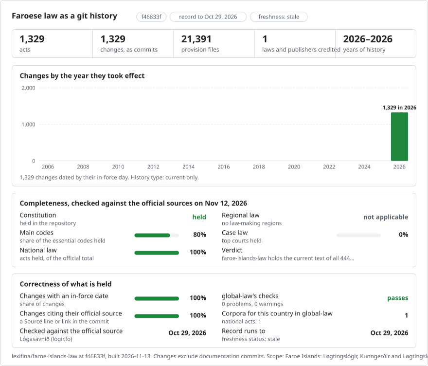

# The laws of the Faroe Islands

<picture>
<source media="(prefers-color-scheme: dark)" srcset="data/effort-dark.svg">

</picture>

Part of [lexifina/global-law](https://github.com/lexifina/global-law), one git history for every country's law: this is Faroe Islands' national law, which global-law reads at `faroe-islands/national/acts/`.

This record preserves 1,329 official current-text acts listed by Lógasavnið (logir.fo) as in force on 29 October 2026: 444 Løgtingslógir, 882 Kunngerðir and 3 Løgtingslógarkunngerðir. The texts are Faroese and, where the source uses it, Danish. Each act has one observed current text, divided into provision and textual-annex files in the reading order in `index.txt`. Earlier wording is not reconstructed.

The source-date correction set preserves every existing law-text file and original commit. It corrects the date claim through labelled append-only metadata records linked by `Corrects` and `Supersedes`.

| Current-text date status | Acts | Meaning |
| --- | ---: | --- |
| Source-dated | 659 | `In-force` is established from the act's commencement clause or the latest source-named amendment. |
| Observation only | 262 | `Text-as-of: 2026-10-29`; entry into force of the full current text is unresolved. No `In-force` date is assigned. |
| Held | 408 | Date ambiguity or source images require further examination. Observed text remains accessible; no verified commencement is claimed. |

`data/source-dates.json` retains source enactment, gazette publication and named amendment dates separately. An observation date is never an entry-into-force date. Source-dated current wording does not establish earlier wording; the record contains only the supplied current text. The source-date records correct the legal commencement claims; the observation reader preserves access to every original observed version. The unchanged historical commits remain visible in git.

Use `python tools/in_force_on.py YYYY-MM-DD ACT-PATH [UNIT]` to read a supported record. The observation reader preserves the published version-selection behavior. Date holds remain visible in metadata and do not remove existing observations; output does not certify legal effect. Consult the source-date records separately for commencement evidence.

There are 31 image-bearing source acts with 107 image references in the observed pages. Those acts are held; this text record does not claim they are complete. The other unresolved date cases are identified in `data/source-dates.json`. This is a partial record, and current coverage beyond the source listing dated 29 October 2026 has not been established.

The statutory text comes from Lógasavnið and is unchanged. Source dates and quotations are retained as supplied. Metadata and tools were prepared with AI assistance and reviewed against official source pages. Lógasavnið states that the text published in Kunngerðablaðið is authoritative.

## Licence
Source: Lógasavnið, https://logir.fo, the Faroese law collection published by Løgmansskrivstovan. The site's footer reads "© Øll rættindi tilskilað" (all rights reserved), but official texts are not protected by copyright in the Faroe Islands: Løgtingslóg nr. 30 frá 30. apríl 2015 um upphavsrætt (Upphavsrættarlógin), § 9, stk. 1, as published on logir.fo (`logtingslog/2015/30/paragraf-9.md`), reads: "Lógir, kunngerðir, rundskriv frá myndugleikum, reglugerðir, dómar og onnur líknandi skjøl, sum tað almenna letur gera, eru ikki vard av upphavsrætti." (Laws, executive orders, circulars from the authorities, regulations, judgments and other similar documents that public authorities have made are not protected by copyright.) Under stk. 2, independent contributions to such documents stay protected, but may be reproduced together with them. The reservation on the site may cover its own material (design, software, editorial apparatus). The wording of the acts was not changed; it was only split into files and lines.  Lexifina's own contributions (the tools, the arrangement and the commit messages) are CC0. See [`LICENSE`](LICENSE).
