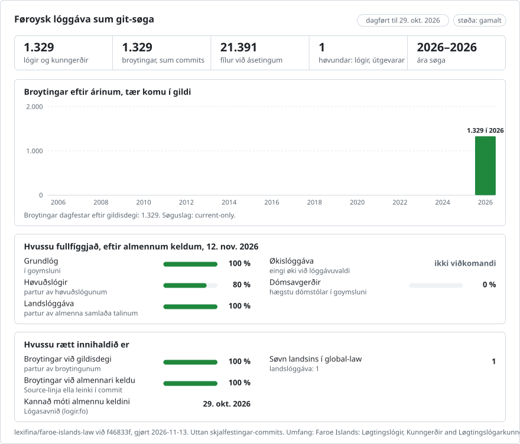

# Lógir Føroya

**Føroyskt** · [English](README.en.md)

<picture>
<source media="(prefers-color-scheme: dark)" srcset="data/fo/effort-dark.svg">

</picture>

Partur av [lexifina/global-law](https://github.com/lexifina/global-law), eini git-søgu fyri lóggávuna í øllum londum: hetta er landslóggáva Føroya, sum global-law lesur í `faroe-islands/national/acts/`.

Hetta savnið varðveitir 1.329 almennar lógir og kunngerðir í núgaldandi orðing, sum Lógasavnið (logir.fo) vísti sum galdandi 29. oktober 2026: 444 løgtingslógir, 882 kunngerðir og 3 løgtingslógarkunngerðir. Tekstirnir eru á føroyskum og, har sum keldan brúkar tað, á donskum. Fyri hvørt skjal er ein núgaldandi tekstur eygleiddur, býttur sundur í fílur við ásetingum og tekstfylgiskjølum í teirri lesiraðfylgju, sum `index.txt` gevur. Eldri orðingar eru ikki endurskapaðar.

Rættingarnar av dagfestingunum eftir keldunum varðveita allar verandi fílur við lógartekstum og allar upprunaligar goymingar (commits). Tær rætta dagfestingarnar við merktum metadátaskrásetingum, sum bert verða løgdar afturat og eru tengdar saman við `Corrects` og `Supersedes`.

| Støða á dagfesting av núgaldandi teksti | Skjøl | Týdningur |
| --- | ---: | --- |
| Dagfest eftir keldu | 659 | `In-force` er staðfest út frá gildiskomuásetingini í skjalinum ella seinastu broytingini, sum keldan nevnir. |
| Bert eygleiðing | 262 | `Text-as-of: 2026-10-29`; tað er ikki avgreitt, nær allur núgaldandi teksturin kom í gildi. Eingin `In-force`-dagur er settur. |
| Hildið aftur | 408 | Óvissa um dagfestingina ella myndir í keldunum krevja nærri kanning. Eygleiddi teksturin er framvegis atkomuligur; einki verður sagt um váttaða gildiskomu. |

`data/source-dates.json` goymir hvørja sær dagfestingarnar fyri samtykt, kunngerð í Kunngerðablaðnum og broytingar, sum keldan nevnir við navni. Ein eygleiðingardagur er ongantíð ein gildiskomudagur. Ein núgaldandi orðing, sum er dagfest eftir keldu, staðfestir einki um eldri orðingar; savnið inniheldur bert tann núgaldandi tekstin, sum keldan veitti. Skrásetingarnar av keldudagfestingunum rætta upplýsingarnar um rættarliga gildiskomu; eygleiðingarlesarin varðveitir atgongd til hvørja upprunaliga eygleidda útgávu. Tær óbroyttu søguligu goymingarnar (commits) síggjast framvegis í git.

Brúka `python tools/in_force_on.py YYYY-MM-DD ACT-PATH [UNIT]` til at lesa eitt skjal, sum amboðið stuðlar. Eygleiðingarlesarin velur útgávur á sama hátt, sum áður er almannakunngjørt. Dagfestingar, sum eru hildnar aftur, síggjast framvegis í metadátunum og taka ikki verandi eygleiðingar burtur; úrslitið váttar ikki rættarvirknað. Hygg serskilt at skrásetingunum av keldudagfestingunum fyri prógv um gildiskomu.

31 skjøl í keldunum hava myndir, við 107 tilvísingum til myndir á teimum eygleiddu síðunum. Hesi skjøl eru hildin aftur; hetta tekstsavnið sigur ikki, at tey eru fullfíggjað. Hini óavgreiddu dagfestingarmálini eru tilskilað í `data/source-dates.json`. Hetta er eitt ófullfíggjað savn, og tað er ikki staðfest, hvussu nógv tað fevnir um útyvir yvirlitið í keldunum frá 29. oktober 2026.

Lógartekstirnir koma úr Lógasavninum og eru óbroyttir. Dagfestingar og sitat úr keldunum eru varðveitt, sum tey vórðu veitt. Metadáta og amboð vórðu gjørd við hjálp frá vitlíki og eftirkannað móti almennu keldusíðunum. Lógasavnið sigur, at tað er teksturin, sum er kunngjørdur í Kunngerðablaðnum, ið er galdandi.

## Nýtsluloyvi
Kelda: Lógasavnið, https://logir.fo, føroyska lógarsavnið, sum Løgmansskrivstovan gevur út. Niðast á heimasíðuni stendur "© Øll rættindi tilskilað", men almennir tekstir eru ikki vardir av upphavsrætti í Føroyum: Løgtingslóg nr. 30 frá 30. apríl 2015 um upphavsrætt (Upphavsrættarlógin), § 9, stk. 1, sum hon er kunngjørd á logir.fo (`logtingslog/2015/30/paragraf-9.md`), ljóðar soleiðis: "Lógir, kunngerðir, rundskriv frá myndugleikum, reglugerðir, dómar og onnur líknandi skjøl, sum tað almenna letur gera, eru ikki vard av upphavsrætti." Eftir stk. 2 eru sjálvstøðug íkøst í slík skjøl framvegis vard, men tey kunnu endurgevast saman við skjølunum. Fyrivarnið á heimasíðuni kann fevna um tilfar, sum heimasíðan sjálv eigur (sniðgeving, ritbúnað, ritstjórnarligt tilfar). Orðingin í skjølunum er ikki broytt; hon er bert býtt sundur í fílur og linjur. Íkøst Lexifina sjálvs (amboðini, skipanin og lýsingarnar av goymingunum) eru CC0. Sí [`LICENSE`](LICENSE).

Hetta er ein umseting av ensku útgávuni ([README.en.md](README.en.md)); um tær eru ólíkar, er tað enska útgávan, sum galdur.

## Meira

Úr goymsluni [lexifina/global-law](https://github.com/lexifina/global-law) (á enskum):

- [FEATURES.md](https://github.com/lexifina/global-law/blob/main/FEATURES.md): allir eginleikar og hvat hvørt savn má stuðla (`git blame`, `law.py`, MCP-amboð)
- [FAQ.md](https://github.com/lexifina/global-law/blob/main/FAQ.md): spurningar og svar · [CONTRIBUTING.md](https://github.com/lexifina/global-law/blob/main/CONTRIBUTING.md): uppskot um broytingar · [MCP.md](https://github.com/lexifina/global-law/blob/main/MCP.md): MCP-ambætari · [REPRODUCE.md](https://github.com/lexifina/global-law/blob/main/REPRODUCE.md): hvussu tað er gjørt · [CHANGELOG.md](https://github.com/lexifina/global-law/blob/main/CHANGELOG.md)
- [FRESHNESS.md](https://github.com/lexifina/global-law/blob/main/FRESHNESS.md): hvussu dagført hvørt savn er · [Eftirlit](https://github.com/lexifina/global-law/tree/main/monitoring): um dagføringarnar virka · [WATCHING.md](https://github.com/lexifina/global-law/blob/main/WATCHING.md): hvussu hvør almenn kelda verður fylgd fyri broytingar
- [performance/](https://github.com/lexifina/global-law/tree/main/performance): hvussu skjót amboðini eru, mált
- [visualisations/](https://github.com/lexifina/global-law/tree/main/visualisations): myndir og sambond tvørtur um lóggávu í øllum heiminum
- [Veikleikar](https://github.com/lexifina/global-law/tree/main/vulnerabilities): feilir í lógum, sum tær eru kunngjørdar
